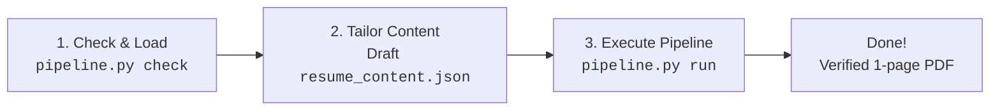

# Resume Builder (Fast 2-Step Agent Architecture)

Creates tailored, ATS-friendly resumes for software engineering (and adjacent) roles end to end:
tailors background to a job description, compiles `.docx` and `.pdf`, verifies page limits deterministically with **zero vision tokens**, records the application, and archives the output.

> [!IMPORTANT]
> **Token Optimization Contract**: All critical drafting rules, banned verbs, engineering bullet formulas, and data schemas are **fully self-contained in this file**. You do **NOT** need to read external files in `references/` during routine drafting. Do **NOT** generate separate `strategy.txt`, `gaps.txt`, or `changelog.txt` files unless the user explicitly asks for them.

---

## Fast 2-Turn Workflow



### Turn 1: Pre-Draft Check & Load Candidate Profile
Run the pre-draft check to confirm profile availability and verify no duplicate application exists:

```bash
python3 scripts/pipeline.py check --company "Acme Corp" --role "Backend Engineer"
```
- If an exact duplicate exists (exit code 1): Stop and confirm with candidate before proceeding (or pass `--force` to `run`).
- If profile is missing: Interview candidate, write `new_info.json`, and run `python3 scripts/resume_store.py profile update --json new_info.json`.
- Read `resume_data/profile.json` (or review stats from `check`).

### Turn 2: Tailor & Execute Unified Pipeline
Draft `resume_content.json` following the writing rules below. Then run the automated build, layout verification, audit, and recording pipeline in **one single command**:

```bash
python3 scripts/pipeline.py run --content resume_content.json --jd job_description.txt \
  --company "Acme Corp" --role "Backend Engineer"
```

What `pipeline.py run` executes automatically:
1. Compiles ATS-compliant `.docx` and `.pdf` (via LibreOffice). Add `--md` or `--txt` if requested.
2. **Deterministic Page-Budget Check**: Verifies PDF page count (target 1 page). If it overflows, exits code 1 with exact advice on trimming bullets — **no vision or image tokens needed**.
3. **ATS Hyphen Check**: Ensures line-end hyphens survived PDF extraction intact.
4. **Keyword Audit**: Reports missing must-have terms and flags any `excluded_skills` leaks.
5. **Durable Recording**: Stores copy under `resume_data/applications/<id>/` and updates tracker index.
6. **Desktop Archive**: Copies PDF to `~/Desktop/resume-applications/<DD>-<mmm>/<First_Last>_<Role>.pdf`.
7. **Web Tracker Sync**: Updates phone tracker at `/tracker/` (gracefully skips if offline).

In your final response to the user, provide a friendly completion summary and include 2-4 bullet points under **Gaps & Verification Notes** if any unverified numbers or missing JD requirements exist.

---

## Resume Writing Rules & Quality Standards

### 1. Formatting Constraints (Enforced by Script & Page Budget)
- **Page Budget**: Strict **1 page** for early-to-mid career (<8 years). **2 pages permitted only for Staff+, Principal, Architects, or 8+ years** (page 2 must fill at least 60%; never allow a 2-3 line spillover). If an overflow occurs, cut the single weakest bullet.
- **ATS Safety**: Single-column body layout only. No tables, text boxes, columns, headers/footers, or graphics. Standard fonts only (Calibri, Arial, Garamond), 10pt minimum body text.

### 2. Section Order by Seniority

ATS parsers require standard headings. Choose `section_order` based on JD seniority:

| Seniority Signal | Section Order (after contact + headline/summary) |
|---|---|
| **New Grad / Intern / <3 years** | Skills, Education, Projects, Work Experience, Awards |
| **Mid-level / Default** | Skills, Work Experience, Education, Projects, Awards |
| **Senior / Staff / 8+ years** | Skills, Work Experience, Projects (architecture-heavy first), Education, Awards |

Standard heading names: `Skills`, `Work Experience`, `Education`, `Projects`, `Awards, Accolades and Certifications`.

### 3. Headline & Summary Formula
- **Headline**: Replaces generic "Professional Summary". Aim for under 10 words, role-first, signaling depth or specialty:
  *e.g. "Senior Backend Engineer, 6 years scaling payments on Go/Postgres"*
- **Summary**: Maximum ~50 words. Active voice, role-targeted, written LAST. Distills verified accomplishments; never repeats the headline.

### 4. Contact Information
Single line, pipe-separated (`|`): Full Name, personal phone, city/state, personal email, LinkedIn, optional GitHub/portfolio. Never include full street addresses, company emails, or photos.

### 5. Skills Section
Group by category, separated by colons and pipes:
`Languages: Java | Go | Python | SQL`
- **Excluded Skills**: Legacy technologies listed in profile `excluded_skills` (e.g. jQuery, SVN) must be suppressed during tailoring unless explicitly demanded by the JD.

---

### 6. Work Experience & The 2026 Grounded Engineering Formula

Format header: `Company, Location | Title | MM/YYYY - MM/YYYY (or Present)`.
Every bullet under a job must strictly follow the **Grounded Engineering Formula**:

$$\mathbf{[Active\ Technical\ Verb]} + \mathbf{[System\ Context\ \&\ Challenge]} + \mathbf{[Architecture\ /\ Tool\ Choice]} + \mathbf{[Verifiable\ Outcome\ /\ Scale]}$$

#### Zero Fabrication Policy (Hard Constraint)
Never invent numbers, tools, or ownership. Every metric must trace to `profile.json` or explicit candidate confirmation. If a metric is unverified, keep the honest wording and flag it under **Verification Notes** in your chat response. Treat `agent_notes` in the profile as binding scope boundaries.

#### Anti-"AI Slop" Guidelines (2026 Standards)
- **Banned Generic Filler Verbs**: Do NOT use *"leveraged"*, *"spearheaded"*, *"orchestrated"*, *"championed"*, *"pioneered"*, or *"utilized"*. Avoid robotic corporate buzzwords: *"delve"*, *"tapestry"*, *"multifaceted"*, *"game-changer"*, *"cutting-edge"*.
- **Required Technical Verbs**: Use precise engineering action verbs: *"Architected"*, *"Profiled"*, *"Refactored"*, *"Migrated"*, *"Benchmarked"*, *"Decomposed"*, *"Hardened"*, *"Provisioned"*, *"Automated"*.
- **Anchor with Real Engineering Units**:
  - Throughput/Latency: QPS, concurrent connections, P99/P95 latency in ms.
  - Financial/FinOps: AWS/GCP cloud spend cut by $X/month, GPU hours reduced.
  - Data Scale: DB volume (GB/TB), daily active records processed.
  - Reliability: Error rate dropped from X% to Y%, SLA uptime achieved.
- **Explain the Architectural "Why"**: e.g., *"decoupled checkout via Kafka to eliminate synchronous database locks"*.

#### Humanization / De-AI Checklist
- [ ] No banned filler verbs in any section.
- [ ] No two adjacent bullets open with the same verb or grammatical structure.
- [ ] Sentence lengths vary; rhythmic variety across bullets.
- [ ] Third-person telegraphic: drop "I", "my", "we", and needless articles.
- [ ] Understated numbers: never round up (e.g., 6.7 is "over 6.5", never "nearly 7").
- [ ] Cut filler phrases on sight: *in order to* $\rightarrow$ *to*, *responsible for* $\rightarrow$ *built/led*, *at this point in time* $\rightarrow$ *now*.

---

### 7. Projects, Education, Awards
- **Projects**: 2-4 achievement bullets per project using the same engineering formula (verb + challenge + architecture + outcome). Heading: `Name, Tech1, Tech2` with optional hyperlink.
- **Education**: Degree, grad year, school, location. Include GPA only if $\ge 3.5/4.0$.
- **Awards**: `Year | Notable quantified win | Name of award`. Skip section if nothing genuinely relevant exists.

### 8. Keyword Optimization & The Top-Third Test
- **Contextual Co-occurrence**: Embed must-have JD tools and domain concepts inside concrete Work Experience bullets, not in disconnected keyword dumps.
- **Surface 2026 Competencies**: Cloud FinOps / spend optimization, AI/vector search, and modern observability (OpenTelemetry, SLO/SLA management).
- **Abbreviations**: Spell out acronyms at least once: *"Google Cloud Platform (GCP)"*, *"Amazon Web Services (AWS)"*.
- **The Top-Third Test**: A recruiter's initial screen takes under 8 seconds. The top third of page 1 (headline, summary, skills, and current role's first bullets) must independently sell the candidacy.

### 9. What Never Belongs
Omit photos, date of birth, age, marital status, full street addresses, salary history/expectations, generic hobbies, and "References available on request".

### 10. Optional Cover Letter
If requested: Keep under 1 page, reader benefit first, address a named human, develop one specific story, and close with a date-owned next step.

---

## Data Schemas

### `resume_content.json` (Input to `pipeline.py run`)

```jsonc
{
  "contact": {
    "name": "Jayadithya R",
    "phone": "+91 ...",
    "location": "Chennai, India",
    "email": "name@example.com",
    "linkedin": "linkedin.com/in/...",
    "github": "github.com/..."
  },
  "headline": "Backend Engineer, 4 years scaling Go & distributed pipelines",
  "summary": "Specialized in event-driven microservices and database query optimization. Architected Kafka pipelines cutting P99 latency by 40% at 80k QPS.",
  "skills": [
    {"category": "Languages", "items": ["Go", "Python", "SQL"]},
    {"category": "Infrastructure", "items": ["AWS", "Docker", "PostgreSQL", "Kafka"]}
  ],
  "experience": [
    {
      "company": "Acme Cloud",
      "location": "Bengaluru, India",
      "title": "Software Engineer",
      "start": "03/2023",
      "end": "Present",
      "bullets": [
        "Architected Kafka event streams to decouple checkout from inventory, achieving zero message loss during peak sales at 80k QPS.",
        "Profiled relational queries and re-indexed PostgreSQL partitions, reducing RDS CPU utilization by 35%."
      ]
    }
  ],
  "education": [
    {
      "degree": "B.Tech in Computer Science",
      "school": "University Name",
      "location": "City, India",
      "grad_year": "2024",
      "achievements": []
    }
  ],
  "projects": [
    {
      "name": "CacheEngine",
      "tech": ["Go", "Raft"],
      "url": "github.com/user/cache-engine",
      "bullets": [
        "Engineered an in-memory key-value cache with consistent hashing and leader election, sustaining 65k read QPS."
      ]
    }
  ],
  "awards": [],
  "section_order": [
    "contact", "headline_summary", "skills", "experience", "education", "projects", "awards"
  ]
}
```

### `profile.json` (Master Record under `<data-dir>/profile.json`)
The candidate's cumulative work history. Structure matches `resume_content.json`, but contains **all** past accomplishments, `excluded_skills: [...]`, and optional binding `agent_notes: "..."` per job/project. Update incrementally with:
`python3 scripts/resume_store.py profile update --json new_info.json`.

---

## Utility Scripts Reference

- `scripts/pipeline.py` — Unified CLI: pre-draft duplicate checks, automated build, deterministic page-budget check, audit, recording, and desktop archive.
- `scripts/build_resume_docx.py` — ATS docx/PDF builder.
- `scripts/keyword_audit.py` — Deterministic keyword coverage auditor.
- `scripts/resume_store.py` — Low-level profile and application tracker store (`profile show`, `app list`, `app view`).
- `scripts/tracker_push.py` — Syncs applications to the Grey Matter web tracker (`/tracker/`).
- `scripts/archive_resume.py` — Archives finished resume PDF to `~/Desktop/resume-applications/<DD>-<mmm>/`.
